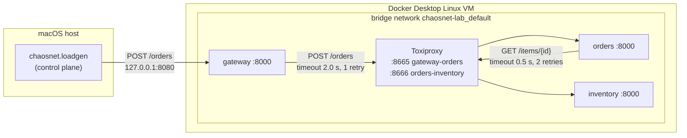

# Architecture

This document describes what exists **today**. Planned components are marked as
planned and link to the decision that introduced them.

## Overview

ChaosNet runs entirely on one machine (ADR-002: local-first). It has two halves:

- **Data plane: the lab.** A small distributed system that real requests flow
  through and that experiments disrupt. Today: `gateway -> orders -> inventory`,
  three FastAPI services in Docker Compose (`lab/`), with every link going through
  Toxiproxy so faults can be injected per link.
- **Control plane.** Decides what runs and measures it, but never carries lab
  traffic itself. Today it consists only of the open-model load generator
  (`backend/src/chaosnet/loadgen.py`), the fault driver and fault CLI
  (`faults.py`, `fault_cli.py`). The experiment controller and reconcile (cleanup
  layer 2) are planned (ADR-001, M3).

## Components

| Component | Code | Responsibility |
|---|---|---|
| gateway | `lab/src/chaosnet_lab/gateway.py` | Single entry point. Forwards orders to `orders`. |
| orders | `lab/src/chaosnet_lab/orders.py` | Looks the item up in `inventory`. |
| inventory | `lab/src/chaosnet_lab/inventory.py` | Leaf service; items in memory. |
| `call_downstream` | `lab/src/chaosnet_lab/client.py` | Per-attempt timeout, retries on transport failure, 503/504 classification. Shared by gateway and orders. |
| `relay`, `Hop` | `lab/src/chaosnet_lab/relay.py` | Hop config from env (validated at startup), error mapping, `path` propagation. |
| load generator | `backend/src/chaosnet/loadgen.py` | Open-model load at a fixed rate; latency from scheduled send time; JSON report. |
| `percentile` | `backend/src/chaosnet/stats.py` | Nearest-rank percentiles for reports. |
| watchdog | `lab/src/chaosnet_lab/watchdog.py` | Cleanup layer 3: `POST /heartbeat` renews a 5 s lease; when it expires, `POST /reset` on Toxiproxy, retried until it succeeds. API on `127.0.0.1:8475`. |
| fault driver + CLI | `backend/src/chaosnet/faults.py`, `fault_cli.py` | Add/remove/list faults per link and direction; the CLI holds a fault for a fixed time, removes it on exit, SIGINT and SIGTERM (layer 1), and sends heartbeats. |
| Toxiproxy | `lab/compose.yaml`, `lab/toxiproxy.json` | One proxy per link, recreated from the config file on every start; API on `127.0.0.1:8474`. No measurable latency overhead (EXP-001b). |

All three services are built from **one image** and differ only in their start
command and environment. Distribution is a property of the running system (three
processes, three network namespaces, independent failures), not of how the code is
organised.

## Request flow

1. The load generator sends `POST /orders {"item_id": "42"}` to `127.0.0.1:8080`.
   Docker Desktop forwards it into the VM to `gateway:8000`.
2. `gateway` calls `http://toxiproxy:8665` (proxy `gateway-orders`), which forwards
   to `orders:8000`. Names are resolved by Docker's embedded DNS (`127.0.0.11`),
   then ARP finds the MAC on the bridge.
3. `orders` calls `GET /items/42` on `http://toxiproxy:8666` (proxy
   `orders-inventory`), which forwards to `inventory:8000`.
4. `inventory` answers with the item and `"path": ["inventory"]`; each service on
   the way back prepends its name, so the client receives
   `"path": ["gateway", "orders", "inventory"]`.

Failure handling per hop (`call_downstream`):

| What happens downstream | Seen by the caller | Response |
|---|---|---|
| answers with any HTTP status (200, 404, 503...) | response | passed through unchanged, no retry |
| no connection could be made (request never sent) | `ConnectError`, `ConnectTimeout` | always retried; then **503** / **504** |
| container stopped behind the proxy: the proxy accepts, then cuts the connection | `ReadError`, `RemoteProtocolError` | retried **only for GET**; then **503** |
| process frozen or too slow (request sent) | `ReadTimeout` | retried **only for GET**; then **504** |

Requests that may already have been processed are never repeated for non-idempotent
methods: repeating a POST such as "pay" could apply it twice.

A caller's timeout must exceed the callee's whole retry budget,
`(retries + 1) × timeout`, otherwise the caller gives up first, retries
(multiplying load downstream) and blames the wrong hop. With the defaults:
orders→inventory budget 1.5 s < gateway→orders timeout 2.0 s.

## Fault cleanup (verified on the lab)

| How the fault's owner ends | Who removes the fault | Measured |
|---|---|---|
| duration over, Ctrl+C, `kill` | the CLI itself (layer 1) | ~2–3 s after the signal |
| `kill -9`, crash, frozen machine | the watchdog (layer 3) | 4.9 s after `kill -9` |
| control plane restarted | reconcile (layer 2) | planned for M3 |

## Networking rules

- Only the gateway (traffic), the Toxiproxy API and the watchdog API (control) are published,
  only on `127.0.0.1`. Every request enters through the path where faults are
  injected; nothing can bypass it.
- The control plane reaches the lab only through published ports and the Docker
  API, never through container IPs (unreachable from macOS, see below).
- Services address each other by Compose service name, never by IP.

## Decisions

See [DECISIONS.md](DECISIONS.md): ADR-001 (control plane structure and fault
cleanup), ADR-002 (local-first execution).

## Verified environment assumptions

Spike #12, run on 2026-10-13. Everything below was measured with the commands
listed. Nothing was taken from documentation alone.

### Environment

| | |
|---|---|
| Host | Apple Silicon Mac (arm64), macOS 26.6 |
| Docker Desktop | 4.95.0 |
| Docker Engine / client | 29.8.2, linux/arm64 |
| Docker Compose | v5.6.0 |
| Docker VM | kernel `7.0.14-linuxkit`, 10 CPUs, ~7.7 GiB RAM |

All images used run natively on arm64: `ghcr.io/shopify/toxiproxy:2.12.0`,
`python:3.14-slim`, `alpine:3.22`.

### Toxiproxy

Setup: `curl` on the Mac, then a published port, then Toxiproxy, then a
`python -m http.server` upstream container on a user-defined bridge network.
Five sequential requests per case:

| Case | `curl` time_total (s) |
|---|---|
| No toxic | 0.0008–0.0014 |
| `latency` 300 ms, `downstream` | 0.303–0.309 |
| `latency` 300 ms on both `downstream` and `upstream` | 0.607–0.613 |
| After `POST /reset` | 0.0017–0.0022 |

Findings:

- A latency toxic delays one direction only. A delay on both streams adds up.
  To model a link with RTT *x*, apply *x*/2 per direction, or *x* on one
  direction, and document which.
- Measured latency exceeded the configured value by about 2–8 ms in this
  setup.
- `POST /reset` returns `204` and removes all toxics while keeping proxies. The
  ADR-001 watchdog can rely on it.
- **Restarting the Toxiproxy container deletes all proxies, not just toxics**
  (`GET /proxies` returned `{}` after `docker restart`). Consequences:
  - the watchdog must use `POST /reset`, never a container restart, to clear
    faults;
  - proxy definitions must be recreated idempotently on every Toxiproxy start
    (for example with a `-config` file), or the services behind them become
    unreachable.

### tc netem

| Case | `ping` RTT avg (ms), 5 packets |
|---|---|
| Container to container, no qdisc | 0.17 |
| `tc qdisc add dev eth0 root netem delay 100ms` on the pinging container | 103.6 (min 101.2, max 105.4) |
| After `tc qdisc del` | 0.20 |

Findings:

- `sch_netem` is available in the Docker Desktop VM kernel and works inside a
  container with `--cap-add NET_ADMIN`.
- Without `NET_ADMIN` it fails with `RTNETLINK answers: Operation not
  permitted`, so the capability gate works as expected.
- The measured delay exceeded the configured value by 1–5 ms. Netem results are
  emulation in a VM, not physical network behaviour.

### Host reachability

| Target from the Mac | Result |
|---|---|
| Published port `127.0.0.1:8474` | HTTP 200 |
| Container IP `172.18.0.2:8000` | unreachable (curl timeout after 3 s) |

This confirms the networking rule: the control plane reaches the lab only
through published ports and the Docker API, never through container IPs.

### Docker DNS and paused containers

Verified in #13 on the demo lab.

- Services resolve each other through Docker's embedded DNS (`inventory` resolved to
  `172.18.0.2` from inside `orders`).
- After `docker stop inventory`, the name no longer resolves at all:
  `gaierror [Errno -2] Name or service not known`. The caller sees a name
  resolution failure, not "connection refused", and it fails fast (gateway answered
  503 in ~10 ms).
- `docker pause` freezes the processes. Callers get no answer and hang until
  their timeout (504 after 1.52 s with a 0.5 s timeout and 2 retries). Not yet
  verified at packet level whether new TCP handshakes still complete (the kernel
  keeps running) or only pooled keep-alive connections are affected.
- **A paused container is reported as `unhealthy` immediately**, and stays
  unhealthy after `docker unpause` until its next successful probe (up to one
  healthcheck interval). During that window `docker compose up --wait` refuses to
  start services that depend on it. The control plane must not treat Docker health
  as ground truth during or right after a pause fault.

### Not verified yet

- Behaviour under load (all measurements above are five sequential requests).
- Netem on interfaces of containers other than the one running `tc`, for example
  from a sidecar sharing the network namespace. Needed in M8.
